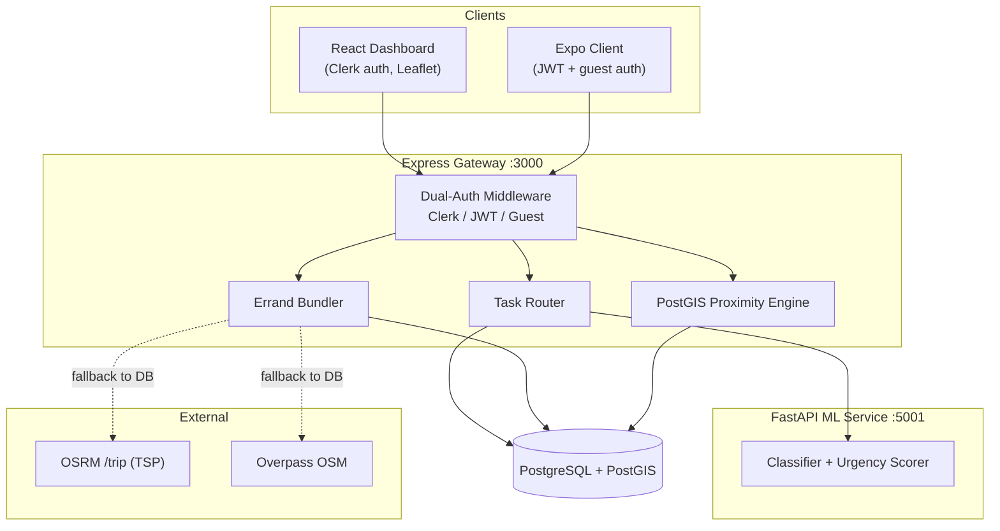

# GeoMind

**Errand batching and route optimization.** Type tasks in plain language — *"pick up asthma inhaler before dinner"* — and GeoMind infers what kind of place you need, groups tasks that share a destination type, finds real stores nearby, and computes an efficient visit order.

> **Status:** working prototype. The web dashboard and backend are functional end to end. Proactive background reminders are **not** implemented — see [Known limitations](#known-limitations) before evaluating this as a finished product.

<!-- TODO: add live demo link + 60s screen recording here -->

---

## What this project is actually about

The interesting engineering here isn't the text classifier — it's the orchestration layer around it. Every external dependency in the request path can fail, and the system is built so that none of them take the product down:

| Dependency | Failure mode | What happens |
|---|---|---|
| Overpass OSM (live store data) | Outage, rate limit, timeout | Falls back to locally stored POIs in PostGIS; whole-request deadline caps the wait at 8s |
| OSRM (route optimization) | Non-200, malformed payload, socket error | Falls back to Haversine-ordered route; the response flags which router produced it, and the user is told |
| ML service (categorization) | Low confidence (<0.60) | Cosine similarity against category centroids assigns a label rather than failing |

The response also carries an `explainability` array so the user sees *why* a store was chosen — distance, urgency, prior visits, and whether the route came from the real router or the estimate.

### Spatial indexing: a bug worth describing

The proximity query compares a `geometry` column against `ST_GeogFromText(...)`, which forces a `geom::geography` cast. A plain `GIST (geom)` index **cannot serve that cast** — so every location check was silently doing a full sequential scan.

Benchmarked on 100,018 rows (Prayagraj bounding box, synthetic):

```
Before:  Parallel Seq Scan on places     1,135.94 ms
After:   Bitmap Index Scan on idx_places_geom   70.53 ms
```

~16x faster. Fixed by migrating `places.geom` to `geography(Point, 4326)` so the column index is used natively, rather than adding an expression index and requiring every future query to remember the cast syntax.

Raw plans: [`docs/perf/explain-before.txt`](docs/perf/explain-before.txt) · [`docs/perf/explain-after.txt`](docs/perf/explain-after.txt)

---

## Architecture



### Components

**Dual-auth gateway** — one middleware resolves three identity sources in priority order: HMAC-SHA256 JWT (`Authorization: Bearer`, mobile), guest ID (`X-Guest-ID`, matching `guest_[A-Za-z0-9_-]{8,80}`, for zero-friction onboarding), then Clerk session validation (web).

**Proximity engine** — spatial work is delegated to PostGIS rather than computed in JS. `ST_DWithin` against a GIST index, with per-task `cooldown_minutes` and a 30-minute per-category cooldown to prevent notification spam.

**Errand bundler** — groups pending tasks by category (capped at 5 per category, priority-sorted), harvests candidate stores, ranks them, and asks OSRM to solve the visit order as a TSP.

**Preference learning** — completed tasks log store name and rating to `user_habits`. Stores are scored `min(1.0, visits × 0.15 + max(0, rating − 3) × 0.2)`, so places you actually use surface first.

**Task categorization** — TF-IDF (unigrams + bigrams) into L2-regularized logistic regression, trained on 611 samples across 4 categories. 90.2% accuracy, 90.6% macro F1 on a stratified 123-sample test split. Below 0.60 confidence, cosine similarity against category centroids takes over. Inference is sub-millisecond on CPU.

**Why local inference instead of an LLM:** task text and location are among the most sensitive data a user can hand an app. Keeping classification local means no third-party provider ever sees either, and the service runs offline on a cheap CPU node. The tradeoff is real — an LLM would extract structure this pipeline throws away (deadlines, specific items, constraints). That's a deliberate deferral, not an oversight.

---

## Known limitations

Listed plainly because they determine whether this is useful to you.

**No background operation.** Location tracking is a foreground `setInterval` polling every 2 minutes, and push/local notifications are stubbed out (`Notifications = null`) due to native module incompatibility in Expo Go SDK 54. The app only checks proximity while open and on screen. Making this work requires an Expo Dev Client with `expo-task-manager` and `expo-location` registering OS-level geofences — a known, scoped piece of work that has not been done.

**In practice this means GeoMind currently works as a trip planner, not a proactive reminder system.** Open it, see your batched errands, get a route.

**Store opening hours are ignored.** Raw OSM `opening_hours` strings are passed through and displayed, but nothing parses or filters on them. The router will happily send you to a closed pharmacy.

**Urgency time-decay is inert.** The scorer implements an age-based boost (+0.10 at 3 days, +0.20 at 7), but the server never passes `created_at`, and urgency is computed once at task creation when age is always zero. The code path exists and is unreachable.

**Feedback never retrains anything.** Client corrections append to `ml/data/feedback_data.csv`. `train.py` can ingest that file, but no scheduler, worker, or endpoint ever invokes it. Retraining is a manual offline step.

**`/location` issues N+1 queries.** Pending tasks are evaluated in a loop, each doing its own SELECT, UPDATE, and INSERT. At 50 pending tasks that's ~150 round-trips per location ping. Needs rewriting as a single batched query with a `LATERAL` join.

**`/health` is partially honest.** Database and ML service are genuinely probed. OSRM and Overpass status are read from environment variables, not checked.

**External services are demo infrastructure.** Public Overpass endpoints and the OSRM demo server are community resources with usage limits that forbid production or commercial traffic. Any real deployment needs self-hosted OSRM (Docker + a regional `.osm.pbf` extract) and either a self-hosted Overpass instance or a commercial POI provider.

**Test coverage is thin.** 10 tests covering the OSRM fallback path and the proximity query. No frontend, mobile, or ML tests.

---

## Running it

### Prerequisites
Node 18+ · Python 3.9+ · PostgreSQL with PostGIS

### Database

```bash
createdb geomind
psql -d geomind -c "CREATE EXTENSION IF NOT EXISTS postgis;"
psql -d geomind -f server/migrations/001_phase1_smart_errand.sql
psql -d geomind -f server/seed.sql
```

### Backend

```bash
cd server
npm install
cp .env.example .env     # set DATABASE_URL, JWT_SECRET, CLERK_SECRET_KEY
npm start
```

`JWT_SECRET` is required — mobile registration and login return 503 without it.

### ML service

```bash
cd ml
python3 -m venv .venv && source .venv/bin/activate
pip install -r requirements.txt
python3 train.py          # writes classifier.pkl, vectorizer.pkl, prototypes.pkl
python3 app.py
```

Model binaries are not committed; `train.py` regenerates them in a few seconds.

### Web dashboard

```bash
cd web && npm install && npm start
```

### Mobile client

```bash
cd mobile && npm install && npx expo start
```

---

## API

### `GET /api/smart-bundle`

Params: `lat`, `lng`, `radius` (default 2000)

```json
{
  "bundles": [{
    "category": "grocery",
    "best_store": {
      "name": "D-Mart Civil Lines",
      "lat": 25.4540, "lng": 81.8340,
      "distance_m": 180,
      "preference_score": 0.95,
      "source": "local_postgis"
    },
    "tasks": [{
      "id": 12,
      "text": "buy organic milk",
      "priority": "high",
      "urgency_score": "0.78",
      "urgency_reason": "urgently, running out"
    }],
    "task_count": 1,
    "avg_urgency": 0.78,
    "explainability": [
      "D-Mart Civil Lines is close (180m away)",
      "Urgency: High (78%)",
      "Frequently visited store from completion history"
    ]
  }],
  "route": {
    "ordered_stops": [{ "name": "D-Mart Civil Lines", "lat": 25.4540, "lng": 81.8340 }],
    "geometry": [[25.4322, 81.7707], [25.4540, 81.8340]],
    "total_distance_m": 180,
    "total_time_min": 2,
    "osrm_used": true
  }
}
```

`osrm_used: false` means the straight-line fallback produced the route; the explainability array says so too.

### `GET /health`

Reports database and ML service health from live probes; OSRM and Overpass status reflect configuration only.

---

## Schema

```sql
CREATE TABLE smart_tasks (
  id               SERIAL PRIMARY KEY,
  user_id          TEXT NOT NULL,
  raw_text         TEXT NOT NULL,
  category         VARCHAR(50),
  priority         VARCHAR(10) DEFAULT 'medium',
  status           VARCHAR(20) DEFAULT 'pending',
  radius_meters    INT DEFAULT 1000,
  urgency_score    FLOAT DEFAULT 0.5,
  urgency_reason   TEXT,
  triggered_at     TIMESTAMP,
  created_at       TIMESTAMP DEFAULT NOW(),
  cooldown_minutes INT DEFAULT 30
);

CREATE TABLE places (
  id          SERIAL PRIMARY KEY,
  user_id     TEXT,
  name        TEXT,
  category    VARCHAR(50),
  price_level INT,
  rating      FLOAT,
  geom        geography(Point, 4326)   -- geography, not geometry: see indexing note above
);

CREATE INDEX idx_places_geom ON places USING GIST (geom);

CREATE TABLE user_habits (
  id           SERIAL PRIMARY KEY,
  user_id      TEXT NOT NULL,
  task_id      INT,
  category     VARCHAR(50),
  item_text    TEXT,
  store_name   TEXT,
  rating       INT,
  completed_at TIMESTAMP DEFAULT NOW()
);

CREATE TABLE trigger_events (
  id            SERIAL PRIMARY KEY,
  user_id       TEXT NOT NULL,
  task_id       INT REFERENCES smart_tasks(id) ON DELETE CASCADE,
  category      VARCHAR(50),
  place_name    TEXT,
  distance_m    INT,
  radius_meters INT,
  priority      VARCHAR(10),
  urgency_score FLOAT,
  reason        JSONB DEFAULT '[]'::jsonb,
  triggered_at  TIMESTAMPTZ DEFAULT NOW()
);
```

---

## Roadmap

In rough priority order:

1. Background geofencing via Expo Dev Client — restores the proactive reminder premise
2. Opening-hours parsing and filtering
3. Self-hosted OSRM and POI source
4. Batch the `/location` proximity evaluation into a single query
5. Wire `created_at` through to the urgency scorer so time-decay activates
6. Calendar integration — surface errands that fit a gap in the day
7. Import from existing task apps (Todoist, Google Tasks, Reminders) to remove the cold-start problem
